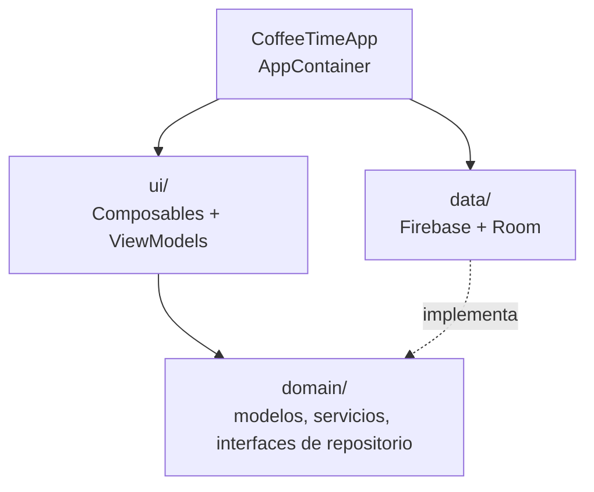

# Coffee Time

App Android de caja para una cafetería (proyecto universitario). La usan el **cajero** (tomar órdenes y cobrar) y el **administrador** (inventario, CRUD de productos, reportes y cierre de caja). Hecha con Kotlin, Jetpack Compose y Material 3.

> La versión de consola (Etapa 2: Kotlin/JVM + SQLite JDBC) quedó guardada en el tag [`etapa-2`](https://github.com/CesarGonzalez2601/coffee-time/tree/etapa-2). Desde la Etapa 3 el repo es un proyecto de Android Studio.

## Video de Presentación

🎥 [Ver video de demostración y presentación en Google Drive](https://drive.google.com/drive/folders/1TgL_vfY3m7yRUuDtY36dNVMFBANiTbbE?usp=sharing)

## Estado de Funcionalidades

| Módulo / Funcionalidad | Descripción | Estado |
| --- | --- | --- |
| **Usuarios y Auth** | Firebase Auth (correo y contraseña; Google en #24), perfiles y roles en Firestore `users/{uid}`, sesión persistente y RBAC por rol | Listo (Google en curso) |
| **Catálogo y Carrito (Órdenes)** | Vista visual por categorías, buscador, carrito con subtotal, IVA (13%) y total | Listo |
| **Procesamiento de Pagos** | Pago efectivo/tarjeta, calculadora de cambio, comprobante con correlativo y ticket | Listo |
| **Gestión de Inventario** | Alertas de stock bajo, ajuste manual, trazabilidad de movimientos y CRUD completo de productos (crear, editar, eliminar) | Listo |
| **Reportes y Cierre de Caja** | Métricas en Inicio, ventas por período (hoy, semana, mes), Top 5 productos más vendidos, arqueo y cierre diario aislado por jornada | Listo |
| **Persistencia Room** | Entidades y DAOs para `Product`, `Order`, `OrderItem`, `Payment`, `InventoryMovement` y `CierreCaja` (pasan a Firestore en #25) | Listo |

## Tech stack

Todas las versiones están fijas en [`gradle/libs.versions.toml`](gradle/libs.versions.toml). No las cambies en tu rama.

| Pieza | Qué usamos |
| --- | --- |
| Lenguaje | Kotlin (JDK 17 para compilar) |
| UI | Jetpack Compose + Material 3 |
| Navegación | Navigation Compose type-safe (`@Serializable`) |
| Estado | ViewModel (MVVM) con StateFlow y Flow reactive streams |
| Autenticación | Firebase Auth (correo/contraseña y Google con Credential Manager) |
| Base de datos | Cloud Firestore para usuarios; Room (SQLite local) v5 para los datos del café hasta #25 |
| DI | Manual, en `AppContainer` |
| Logs | `android.util.Log` (Logcat) |
| Android | minSdk 26 (Android 8.0), compile/targetSdk 37 |

## Correr el proyecto

### Requisitos

- [Android Studio](https://developer.android.com/studio) (trae el SDK, el emulador y un JDK).
- Nada más: el repo incluye el Gradle wrapper.

### Desde Android Studio

1. `File → Open` y elige la carpeta del repo.
2. Espera el *Gradle sync*.
3. Elige un emulador o teléfono y dale *Run ▶*.

### Desde la terminal

Android Studio crea `local.properties` con la ruta del SDK. Si usas solo la terminal, créalo tú:

```properties
sdk.dir=C\:\\Users\\<tu-usuario>\\AppData\\Local\\Android\\Sdk
```

```bash
./gradlew assembleDebug   # genera el APK de debug
./gradlew installDebug    # lo instala en el emulador/teléfono conectado
./gradlew test            # tests JVM (sin emulador)
./gradlew connectedDebugAndroidTest  # tests de Room en el emulador/teléfono
./gradlew lint
```

### Firebase

El proyecto de Firebase es `coffee-time-966f2` y su `app/google-services.json` está en el repo. Para que **Continuar con Google** funcione en tu compu, la SHA-1 de tu llave de depuración tiene que estar registrada:

1. Corre `./gradlew signingReport` y copia la línea `SHA1:` de `Variant: debug`.
2. Mándala a Erick para que la agregue en *Configuración del proyecto → app Android → Huellas digitales del certificado SHA* y suba el `google-services.json` actualizado.

Correo y contraseña funcionan sin este paso. Las reglas de seguridad están en [`firestore.rules`](firestore.rules); se publican desde la consola (*Firestore Database → Reglas*) o con `firebase deploy --only firestore:rules`.

### Cuentas de prueba

| Correo | Contraseña | Rol | Permisos |
| --- | --- | --- | --- |
| `admin@coffeetime.test` | `admin123` | Administrador | Todos (*Crear órdenes, Cobrar, Inventario/CRUD, Reportes/Cierre*) |
| `cajero@coffeetime.test` | `cajero123` | Cajero | *Crear órdenes* y *Cobrar* |

Son cuentas solo para pruebas. Toda cuenta nueva se registra como **cajero**; el rol de administrador se marca a mano en Firestore (`users/{uid}` → `role: "ADMINISTRATOR"`). Al abrir la base por primera vez se siembran **12 productos iniciales** (`SeedCallback`).

## Arquitectura

Tres capas. La UI nunca toca la base de datos: siempre le pide al dominio a través de repositorios.



```
app/src/main/java/com/coffeetime/
├── CoffeeTimeApp.kt        Application; crea el AppContainer
├── MainActivity.kt         setContent { CoffeeTimeTheme { CoffeeTimeNavHost() } }
├── di/AppContainer.kt      Inyección manual de dependencias y repositorios
├── domain/
│   ├── model/              User, AuthAccount, Producto, CategoriaProducto, CartItem, Orden, Pago, MovimientoInventario, CierreCaja
│   ├── exception/          AuthenticationException, InvalidInput, PermissionDenied
│   ├── repository/         UserRepository, ProductRepository, OrderRepository, PaymentRepository, InventoryRepository, CierreCajaRepository
│   └── service/            AuthenticationService, AuthGateway, Session
├── data/
│   ├── firebase/           FirebaseAuthGateway, UserRepositoryFirestore
│   ├── fake/               FakeAuthGateway, FakeUserRepository (pruebas JVM)
│   └── local/              Room: ProductEntity, OrderEntity, OrderItemEntity, PaymentEntity, InventoryMovementEntity, CierreCajaEntity, DAOs, AppDatabase, seed
└── ui/
    ├── theme/              Color, Theme, Type, Shape, Dimens (design system)
    ├── navigation/         Routes.kt + CoffeeTimeNavHost.kt
    ├── login/  registro/  main/
    ├── ordenes/            Catálogo por categoría + Carrito de compras + Desglose financiero
    ├── pagos/              Cobro efectivo/tarjeta + Calculadora de cambio + Historial de pagos + Comprobante
    ├── inventario/         Alertas stock bajo + Ajuste de stock + Historial de movimientos + CRUD Productos
    └── mas/                Arqueo y Cierre de caja aislado + Reportes de ventas (Hoy, Semana, Mes) + Top 5 productos
```

## Diseño

La UI sigue el design system de Coffee Time: tonos de café, Fraunces para títulos, Figtree para el resto, botones en píldora. Fuentes bajo SIL OFL 1.1 (ver [`licenses/`](licenses/)).

## Reglas del equipo

- Textos en `res/values/strings.xml`, en español con **tuteo** ("Ingresa tu correo"). Nunca escritos directo en un Composable.
- Colores, fuentes y tamaños salen de `MaterialTheme` y de `Space` / `Size`.
- Versiones de librerías solo en `libs.versions.toml`.
